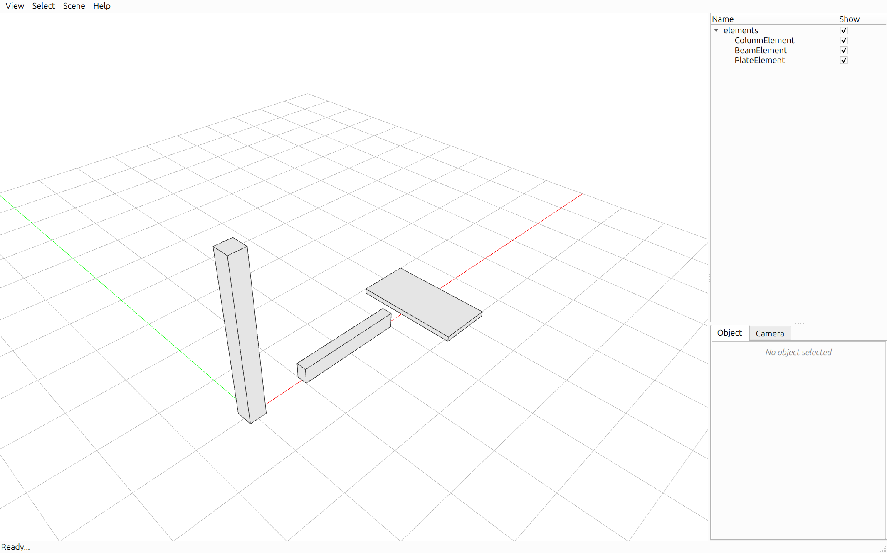
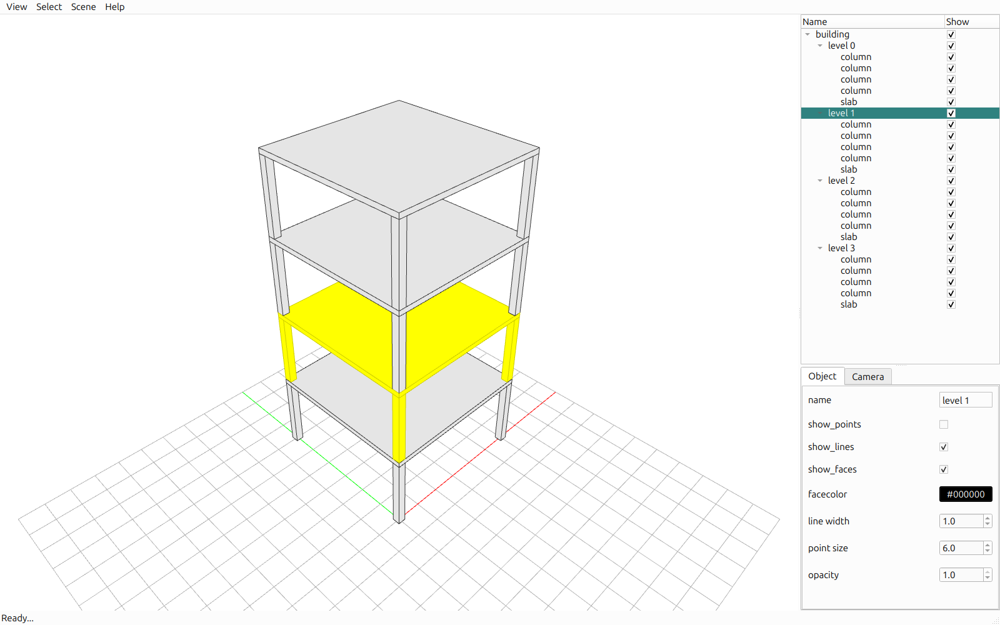
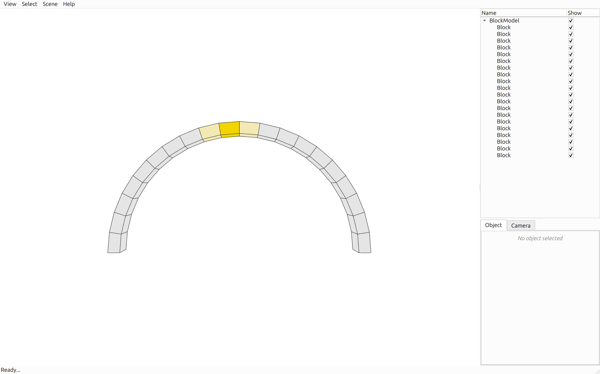
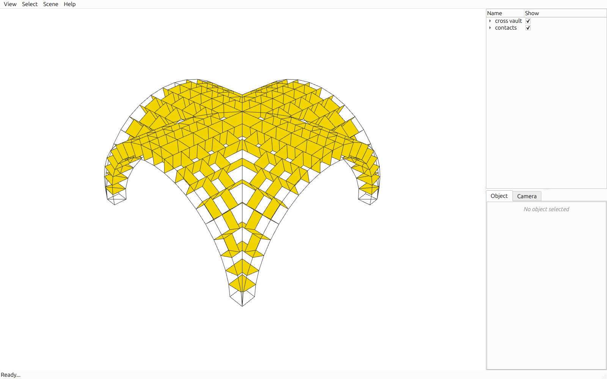
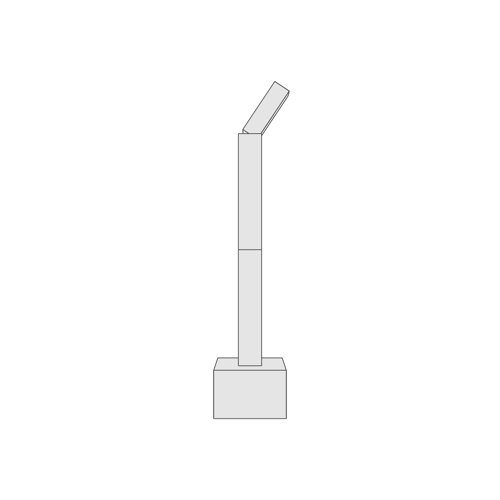
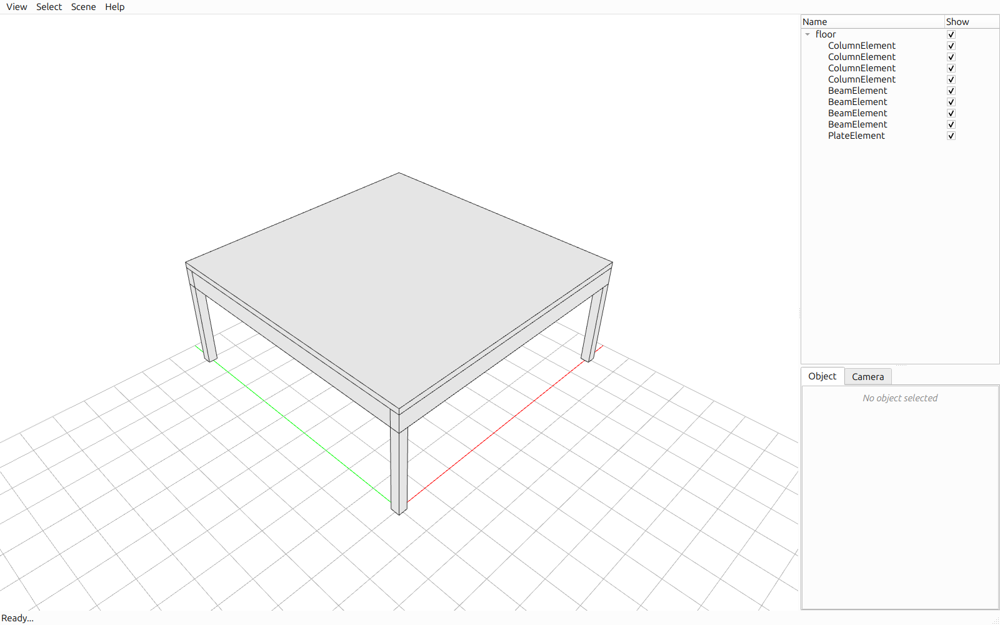

# Examples

-   

    [Creating elements](elements.md)

    Create a model, add a column, a beam and a plate to it, and show the model in the viewer.

-   

    [Element tree](element-tree.md)

    Organise elements in a hierarchy.

-   

    [Interaction graph](interaction-graph.md)

    Find the neighbors of an element.

-   

    [Contact detection](contact-detection.md)

    Detect the contacts between elements.

-   

    [Transformations](transformations.md)

    Position elements relative to their parent.

-   

    [Placing elements](placing-elements.md)

    Place elements precisely relative to each other.

