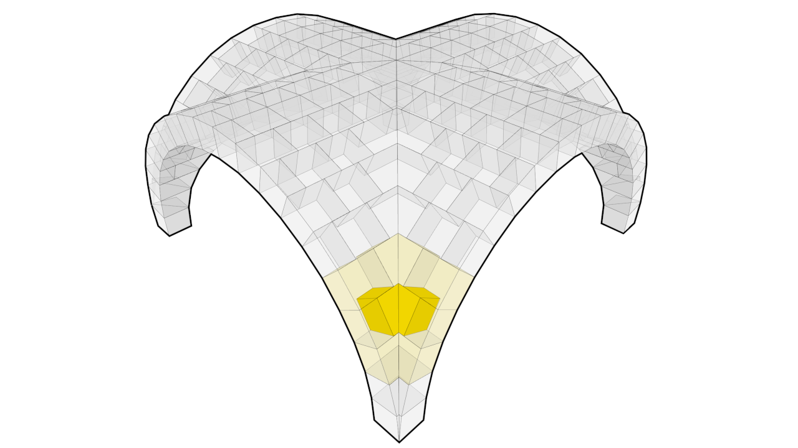

# COMPAS Model

This package provides a universal model datastructure for design, analysis, fabrication, and construction of AEC objects.
A model stores elements (beams, columns, plates, or your own) in a hierarchical tree, and the interactions between them in a graph.
Materials, geometry, and contacts are attached to the same model, so every tool in a workflow reads and writes one shared description.
Inputs, solvers, and viewers all talk to the model, instead of to each other.

See [Installation](installation.md) to get started, and the [Examples](examples/index.md) to see how it is used.
